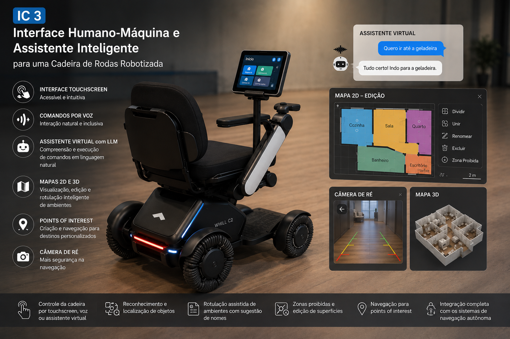

# Assistente Inteligente para Cadeira de Rodas Robotizada

Pesquisa de iniciação científica em robótica assistiva no **AdRoLab - FEEC/Unicamp**, sob orientação do **Prof. Eric Rohmer**, voltada à plataforma **WHILL C2 R**.

**Status: projeto em desenvolvimento.** Este repositório reúne a apresentação inicial da pesquisa. A implementação e os resultados serão documentados conforme o avanço do trabalho.

*Imagem conceitual presente na proposta do projeto. Representa funcionalidades previstas para a pesquisa.*

## Objetivo

Investigar uma interação acessível entre o usuário e a cadeira de rodas robotizada, combinando linguagem natural, comandos de voz e informações semânticas sobre o ambiente.

## Frente de pesquisa

A atuação de **Gustavo Nascimento** concentra-se em:

- Assistente virtual baseado em modelos de linguagem de grande porte (LLMs).
- Processamento de voz e interpretação de solicitações em linguagem natural.
- Percepção e rotulação semântica de ambientes.
- Integração das intenções do usuário aos sistemas da cadeira, em colaboração com as demais frentes do laboratório.

## Contexto do projeto

A proposta mais ampla contempla uma interface humano-máquina acessível, visualização e edição de mapas, gerenciamento de pontos de interesse e integração com os módulos de percepção e navegação da plataforma. Essas funcionalidades são objetivos de pesquisa e desenvolvimento.

## Instituição e orientação

- **Pesquisador de iniciação científica:** Gustavo Nascimento
- **Orientador:** Prof. Eric Rohmer
- **Laboratório:** AdRoLab - Advanced Robotics Laboratory
- **Instituição:** Faculdade de Engenharia Elétrica e de Computação, Universidade Estadual de Campinas (FEEC/Unicamp)
